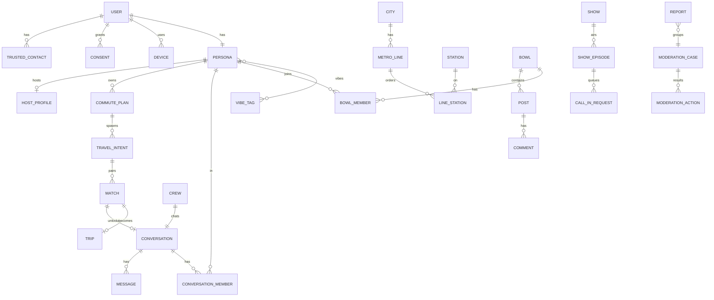

# Metro Buddy - data ontology

Companion to `metro-buddy-spec.md`. Same data as the `Entities`, `Fields` and `Enums` tabs of `metro-buddy-plan.xlsx` - keep them in sync when editing.

## Core concepts

- **Two-layer identity**: `User` is the private human (phone, age, consents). `Persona` is the anonymous public face (alias, avatar, vibes). Every social row references `persona_id`; only the Identity and Safety domains may join to `user_id`.
- **Metro graph**: `City -> MetroLine -> LineStation(seq) -> Station`. Consecutive `seq` on a line are edges; a station on several lines is an interchange node. Route overlap = shared stations on BFS paths.
- **Conversation is polymorphic by `kind`**: dm, group, crew, travel, discussion. One messaging engine, many surfaces.
- **Masked text is canonical**: `*_masked` columns hold post-masking text. Raw text lives only in `PiiVault` (encrypted, 90-day TTL).
- **Consent objects gate contact**: `DmRequest`, `Match` (both sides accept), `RevealEvent` (both sides grant per level).

## Privacy classes

| Class | Meaning | Handling |
|---|---|---|
| P0 | System / public reference | Normal |
| P1 | Pseudonymous - visible to other users under an alias | Masked text only; never joined to User in social APIs |
| P2 | Personal - visible to the owner (and T&S) only | Never in other users' DTOs; included in DPDP export |
| P3 | Sensitive - hashed or encrypted at rest | Never logged; access audited |

## Conventions

- UUIDv7 PKs; `created_at`/`updated_at` everywhere; `deleted_at` soft delete on user content.
- Cursor pagination on `(created_at, id)`; index every FK and filter column.
- Denormalised counters (`score`, `comment_count`, `member_count`) are updated in the same transaction as the source row.

## Entity-relationship overview

## Relationships

| From | Cardinality | To | Note |
|---|---|---|---|
| User | 1:1 | Persona | one active persona per user (v1) |
| User | 1:N | Device / RefreshToken / Consent / TrustedContact |  |
| City | 1:N | MetroLine / Station / Bowl |  |
| MetroLine | N:M | Station | via LineStation(seq) - forms the station graph |
| Persona | N:M | VibeTag | via PersonaVibe |
| Persona | N:M | Bowl | via BowlMember |
| Bowl | 1:N | Post |  |
| Post | 1:N | Comment | Comment.parent_id self-reference, depth<=2 |
| Post | 1:0..1 | Poll | Poll 1:N PollOption 1:N PollVote |
| Persona | N:M | Conversation | via ConversationMember |
| Conversation | 1:N | Message |  |
| DmRequest | 0..1:1 | Conversation | created on accept |
| Persona | 1:N | CommutePlan |  |
| CommutePlan | 1:N | TravelIntent | daily instances; Travel Now has no plan |
| TravelIntent | N:M | TravelIntent | via Match (intent_a, intent_b) |
| Match | 1:0..1 | Trip | on mutual accept |
| Match | 1:0..1 | Conversation | kind=travel |
| Crew | 1:1 | Conversation | kind=crew |
| Persona | 1:0..1 | HostProfile |  |
| Show | 1:N | ShowEpisode |  |
| ShowEpisode | 1:N | CallInRequest / EpisodeParticipant |  |
| Report | N:1 | ModerationCase |  |
| ModerationCase | 1:N | ModerationAction | ModerationAction 1:N Appeal |

## Domain: Identity

### User

Private account. Never exposed to other users. Retention: Until deletion + 30 days.

| Field | Type | Constraints | PII | Note |
|---|---|---|---|---|
| `id` | uuid v7 | PK | P0 |  |
| `created_at` | timestamptz | not null | P0 |  |
| `updated_at` | timestamptz | not null | P0 |  |
| `deleted_at` | timestamptz | nullable, index | P0 | soft delete |
| `phone_hash` | bytea | unique, not null | P3 | HMAC-SHA256(pepper, E.164) |
| `phone_enc` | bytea | not null | P3 | AES-GCM; used only for SMS |
| `status` | enum user_status | not null, index | P0 |  |
| `birth_year` | smallint | not null | P2 | 18+ check; age band derived |
| `gender` | enum gender | nullable | P2 | self-declared; for matching filters only |
| `city_id` | uuid | FK City | P2 |  |
| `verified_at` | timestamptz | nullable | P2 | selfie liveness passed |
| `trust_score` | int | default 50 | P2 | 0-100 |
| `trust_tier` | smallint | default 0, index | P2 | derived from score |
| `locale` | varchar(8) | default 'en' | P2 |  |
| `last_active_at` | timestamptz | index | P2 |  |

### Persona

Public anonymous face. All social objects point here. Retention: Tombstoned on user deletion.

| Field | Type | Constraints | PII | Note |
|---|---|---|---|---|
| `id` | uuid v7 | PK | P0 |  |
| `created_at` | timestamptz | not null | P0 |  |
| `updated_at` | timestamptz | not null | P0 |  |
| `deleted_at` | timestamptz | nullable, index | P0 | soft delete |
| `user_id` | uuid | FK User, unique | P3 | never serialized to other clients |
| `alias` | varchar(40) | unique per city | P1 |  |
| `avatar_seed` | varchar(32) | not null | P1 |  |
| `bio` | varchar(160) | masked | P1 |  |
| `alias_changed_at` | timestamptz | nullable | P0 | 30-day rule |
| `home_station_id` | uuid | FK Station | P2 | never shown to others |
| `work_station_id` | uuid | FK Station | P2 | never shown to others |
| `intents` | text[] | enum persona_intent values | P1 |  |
| `is_host` | bool | default false | P1 |  |

### PersonaAliasHistory

Old aliases for moderation lookups. Retention: Life of account.

| Field | Type | Constraints | PII | Note |
|---|---|---|---|---|
| `id` | uuid v7 | PK | P0 |  |
| `persona_id` | uuid | FK Persona, index | P1 |  |
| `alias` | varchar(40) |  | P1 |  |
| `used_from` | timestamptz |  | P0 |  |
| `used_to` | timestamptz |  | P0 |  |

### Device

Install with push token. Retention: 90 days after last seen.

| Field | Type | Constraints | PII | Note |
|---|---|---|---|---|
| `id` | uuid v7 | PK | P0 |  |
| `created_at` | timestamptz | not null | P0 |  |
| `updated_at` | timestamptz | not null | P0 |  |
| `user_id` | uuid | FK User, index | P3 |  |
| `platform` | enum platform |  | P0 |  |
| `push_token` | text | nullable | P2 |  |
| `app_version` | varchar(16) |  | P0 |  |
| `attestation_ok` | bool | nullable | P0 |  |
| `last_seen_at` | timestamptz |  | P0 |  |

### RefreshToken

Rotating refresh tokens (hashed). Retention: Expiry + 7 days.

| Field | Type | Constraints | PII | Note |
|---|---|---|---|---|
| `id` | uuid v7 | PK | P0 |  |
| `user_id` | uuid | FK User, index | P3 |  |
| `device_id` | uuid | FK Device | P0 |  |
| `family_id` | uuid | index | P0 | revoke whole family on reuse |
| `token_hash` | bytea | unique | P3 |  |
| `expires_at` | timestamptz |  | P0 |  |
| `revoked_at` | timestamptz | nullable | P0 |  |
| `replaced_by` | uuid | nullable | P0 |  |

### Consent

DPDP itemised consent records (append-only). Retention: Life of account + 3 years.

| Field | Type | Constraints | PII | Note |
|---|---|---|---|---|
| `id` | uuid v7 | PK | P0 |  |
| `user_id` | uuid | FK User, index | P3 |  |
| `purpose` | enum consent_purpose |  | P0 |  |
| `granted` | bool |  | P0 |  |
| `policy_version` | varchar(16) |  | P0 |  |
| `created_at` | timestamptz |  | P0 |  |

### TrustedContact

SOS / share-trip recipients. Retention: Until removed.

| Field | Type | Constraints | PII | Note |
|---|---|---|---|---|
| `id` | uuid v7 | PK | P0 |  |
| `created_at` | timestamptz | not null | P0 |  |
| `updated_at` | timestamptz | not null | P0 |  |
| `user_id` | uuid | FK User, index | P3 |  |
| `name` | varchar(60) |  | P2 |  |
| `phone_enc` | bytea |  | P3 |  |

### UserSettings

Per-user preferences. Retention: Life of account.

| Field | Type | Constraints | PII | Note |
|---|---|---|---|---|
| `user_id` | uuid | PK, FK User | P3 |  |
| `match_same_gender_only` | bool | default false | P2 |  |
| `match_verified_only` | bool | default false | P2 |  |
| `match_age_min` | smallint |  | P2 |  |
| `match_age_max` | smallint |  | P2 |  |
| `quiet_hours_start` | time | nullable | P2 |  |
| `quiet_hours_end` | time | nullable | P2 |  |
| `dm_from` | enum dm_policy | default 'requests' | P2 |  |
| `notif_prefs` | jsonb |  | P2 |  |

## Domain: Metro

### City

Metro city. Retention: Reference.

| Field | Type | Constraints | PII | Note |
|---|---|---|---|---|
| `id` | uuid v7 | PK | P0 |  |
| `name` | varchar(40) | unique | P0 |  |
| `code` | varchar(8) | unique | P0 | DEL, MUM, BLR |
| `is_live` | bool |  | P0 |  |

### MetroLine

Line within a city. Retention: Reference.

| Field | Type | Constraints | PII | Note |
|---|---|---|---|---|
| `id` | uuid v7 | PK | P0 |  |
| `city_id` | uuid | FK City, index | P0 |  |
| `name` | varchar(40) |  | P0 | Yellow Line |
| `color_hex` | char(7) |  | P0 |  |
| `gtfs_route_id` | varchar(32) |  | P0 |  |

### Station

Metro station. Retention: Reference.

| Field | Type | Constraints | PII | Note |
|---|---|---|---|---|
| `id` | uuid v7 | PK | P0 |  |
| `city_id` | uuid | FK City, index | P0 |  |
| `name` | varchar(80) | index (trigram) | P0 |  |
| `code` | varchar(16) |  | P0 |  |
| `lat` | numeric(9,6) |  | P0 | station location, public |
| `lng` | numeric(9,6) |  | P0 |  |
| `is_interchange` | bool |  | P0 |  |
| `has_womens_coach_note` | varchar(120) | nullable | P0 |  |

### LineStation

Ordered station on a line (graph edges = consecutive seq). Retention: Reference.

| Field | Type | Constraints | PII | Note |
|---|---|---|---|---|
| `line_id` | uuid | PK part, FK MetroLine | P0 |  |
| `station_id` | uuid | PK part, FK Station | P0 |  |
| `seq` | smallint | not null | P0 |  |
| `platform_hint` | varchar(40) | nullable | P0 |  |

## Domain: Vibe

### VibeTag

Catalog of vibe tags. Retention: Reference.

| Field | Type | Constraints | PII | Note |
|---|---|---|---|---|
| `id` | uuid v7 | PK | P0 |  |
| `slug` | varchar(32) | unique | P0 | indie-music |
| `label_en` | varchar(40) |  | P0 |  |
| `label_hi` | varchar(40) |  | P0 |  |
| `category` | enum vibe_category |  | P0 |  |

### PersonaVibe

Persona <-> VibeTag (3-10 per persona). Retention: Life of persona.

| Field | Type | Constraints | PII | Note |
|---|---|---|---|---|
| `persona_id` | uuid | PK part, FK Persona | P1 |  |
| `vibe_tag_id` | uuid | PK part, FK VibeTag | P0 |  |

## Domain: Community

### Bowl

Fishbowl-style community. Retention: Life of platform.

| Field | Type | Constraints | PII | Note |
|---|---|---|---|---|
| `id` | uuid v7 | PK | P0 |  |
| `created_at` | timestamptz | not null | P0 |  |
| `updated_at` | timestamptz | not null | P0 |  |
| `deleted_at` | timestamptz | nullable, index | P0 | soft delete |
| `city_id` | uuid | FK City, nullable | P0 | null = national |
| `kind` | enum bowl_kind | index | P0 |  |
| `slug` | varchar(48) | unique | P0 |  |
| `name` | varchar(60) |  | P0 |  |
| `description` | varchar(300) |  | P0 |  |
| `line_id` | uuid | FK MetroLine, nullable | P0 |  |
| `station_id` | uuid | FK Station, nullable | P0 |  |
| `visibility` | enum bowl_visibility |  | P0 |  |
| `created_by_persona_id` | uuid | FK Persona, nullable | P1 |  |
| `member_count` | int | denormalised | P0 |  |
| `rules_md` | text |  | P0 |  |

### BowlMember

Membership + role. Retention: Until leave.

| Field | Type | Constraints | PII | Note |
|---|---|---|---|---|
| `bowl_id` | uuid | PK part, FK Bowl | P0 |  |
| `persona_id` | uuid | PK part, FK Persona, index | P1 |  |
| `role` | enum bowl_role |  | P1 |  |
| `joined_at` | timestamptz |  | P0 |  |
| `muted_until` | timestamptz | nullable | P0 |  |

### Post

Anonymous post in a bowl. Retention: Until deleted; 30 days soft.

| Field | Type | Constraints | PII | Note |
|---|---|---|---|---|
| `id` | uuid v7 | PK | P0 |  |
| `created_at` | timestamptz | not null | P0 |  |
| `updated_at` | timestamptz | not null | P0 |  |
| `deleted_at` | timestamptz | nullable, index | P0 | soft delete |
| `bowl_id` | uuid | FK Bowl, index | P0 |  |
| `author_persona_id` | uuid | FK Persona, index | P1 |  |
| `type` | enum post_type |  | P0 |  |
| `title` | varchar(140) | masked | P1 |  |
| `body_masked` | text | masked | P1 |  |
| `flair` | varchar(24) | nullable | P0 |  |
| `media` | jsonb | R2 keys + dims | P1 |  |
| `pii_flags` | smallint | bitmask of masked kinds | P0 |  |
| `status` | enum content_status | index | P0 |  |
| `score` | int | denormalised | P0 |  |
| `comment_count` | int | denormalised | P0 |  |
| `hot_rank` | double | index | P0 |  |
| `is_prompt` | bool |  | P0 | daily prompt |

### Poll

Poll attached to a post. Retention: With post.

| Field | Type | Constraints | PII | Note |
|---|---|---|---|---|
| `post_id` | uuid | PK, FK Post | P0 |  |
| `closes_at` | timestamptz |  | P0 |  |
| `multi` | bool |  | P0 |  |

### PollOption

Poll option. Retention: With post.

| Field | Type | Constraints | PII | Note |
|---|---|---|---|---|
| `id` | uuid v7 | PK | P0 |  |
| `post_id` | uuid | FK Poll | P0 |  |
| `label` | varchar(60) | masked | P1 |  |
| `vote_count` | int |  | P0 |  |

### PollVote

One per persona per option. Retention: With post.

| Field | Type | Constraints | PII | Note |
|---|---|---|---|---|
| `option_id` | uuid | PK part | P0 |  |
| `persona_id` | uuid | PK part | P1 | never shown |

### Comment

Threaded comment (max depth 2). Retention: Until deleted; 30 days soft.

| Field | Type | Constraints | PII | Note |
|---|---|---|---|---|
| `id` | uuid v7 | PK | P0 |  |
| `created_at` | timestamptz | not null | P0 |  |
| `updated_at` | timestamptz | not null | P0 |  |
| `deleted_at` | timestamptz | nullable, index | P0 | soft delete |
| `post_id` | uuid | FK Post, index | P0 |  |
| `parent_id` | uuid | FK Comment, nullable | P0 |  |
| `author_persona_id` | uuid | FK Persona | P1 |  |
| `body_masked` | text | masked | P1 |  |
| `depth` | smallint | 0..2 | P0 |  |
| `status` | enum content_status |  | P0 |  |
| `score` | int |  | P0 |  |

### Vote

Up/down vote on post or comment. Retention: With target.

| Field | Type | Constraints | PII | Note |
|---|---|---|---|---|
| `persona_id` | uuid | PK part | P1 | never shown |
| `target_type` | enum vote_target | PK part | P0 |  |
| `target_id` | uuid | PK part, index | P0 |  |
| `value` | smallint | -1 or 1 | P0 |  |

## Domain: Messaging

### Conversation

DM, group, crew, travel or discussion room. Retention: Until all members leave + 30 days.

| Field | Type | Constraints | PII | Note |
|---|---|---|---|---|
| `id` | uuid v7 | PK | P0 |  |
| `created_at` | timestamptz | not null | P0 |  |
| `updated_at` | timestamptz | not null | P0 |  |
| `deleted_at` | timestamptz | nullable, index | P0 | soft delete |
| `kind` | enum conversation_kind | index | P0 |  |
| `title` | varchar(60) | nullable, masked | P1 |  |
| `bowl_id` | uuid | FK Bowl, nullable | P0 | discussion rooms |
| `match_id` | uuid | FK Match, nullable | P0 | travel chats |
| `crew_id` | uuid | FK Crew, nullable | P0 |  |
| `starts_at` | timestamptz | nullable | P0 | rooms |
| `ends_at` | timestamptz | nullable | P0 | rooms |
| `slow_mode_sec` | smallint | default 0 | P0 |  |
| `disappear_after_sec` | int | nullable | P0 |  |
| `member_cap` | smallint |  | P0 |  |
| `invite_code` | varchar(16) | unique, nullable | P0 |  |
| `last_message_at` | timestamptz | index | P0 |  |

### ConversationMember

Membership + read state. Retention: With conversation.

| Field | Type | Constraints | PII | Note |
|---|---|---|---|---|
| `conversation_id` | uuid | PK part | P0 |  |
| `persona_id` | uuid | PK part, index | P1 |  |
| `role` | enum conv_role |  | P1 |  |
| `last_read_message_id` | uuid | nullable | P1 |  |
| `muted_until` | timestamptz | nullable | P0 |  |
| `reveal_level` | enum reveal_level | default 'none' | P1 | what I agreed to reveal |
| `joined_at` | timestamptz |  | P0 |  |
| `left_at` | timestamptz | nullable | P0 |  |

### DmRequest

Consent gate for 1:1 chat. Retention: 90 days.

| Field | Type | Constraints | PII | Note |
|---|---|---|---|---|
| `id` | uuid v7 | PK | P0 |  |
| `created_at` | timestamptz | not null | P0 |  |
| `updated_at` | timestamptz | not null | P0 |  |
| `from_persona_id` | uuid | FK Persona, index | P1 |  |
| `to_persona_id` | uuid | FK Persona, index | P1 |  |
| `intro_masked` | varchar(200) | masked | P1 |  |
| `context_type` | enum dm_context |  | P0 | post/comment/room |
| `context_id` | uuid | nullable | P0 |  |
| `status` | enum request_status |  | P0 |  |
| `conversation_id` | uuid | nullable | P0 |  |

### Message

Chat message (masked). Retention: Until deleted or TTL.

| Field | Type | Constraints | PII | Note |
|---|---|---|---|---|
| `id` | uuid v7 | PK (client-generated, idempotent) | P0 |  |
| `conversation_id` | uuid | FK, index (conv, id) | P0 |  |
| `sender_persona_id` | uuid | FK Persona | P1 |  |
| `kind` | enum message_kind |  | P0 |  |
| `body_masked` | text | masked | P1 |  |
| `media` | jsonb | nullable | P1 |  |
| `reply_to_id` | uuid | nullable | P0 |  |
| `pii_flags` | smallint |  | P0 |  |
| `status` | enum content_status |  | P0 |  |
| `created_at` | timestamptz |  | P0 |  |
| `edited_at` | timestamptz | nullable | P0 |  |
| `expires_at` | timestamptz | nullable, index | P0 |  |

## Domain: Safety

### PiiVault

Encrypted raw UGC for legal requests only. Retention: 90 days TTL, then hard delete.

| Field | Type | Constraints | PII | Note |
|---|---|---|---|---|
| `id` | uuid v7 | PK | P0 |  |
| `content_type` | enum content_type |  | P0 |  |
| `content_id` | uuid | index | P0 |  |
| `raw_enc` | bytea | AES-GCM | P3 |  |
| `key_version` | smallint |  | P0 |  |
| `expires_at` | timestamptz | index | P0 |  |

### PiiDetection

What was masked (no raw values). Retention: 1 year.

| Field | Type | Constraints | PII | Note |
|---|---|---|---|---|
| `id` | uuid v7 | PK | P0 |  |
| `content_type` | enum content_type |  | P0 |  |
| `content_id` | uuid | index | P0 |  |
| `kind` | enum pii_kind |  | P0 |  |
| `source` | enum detector | regex/llm | P0 |  |
| `created_at` | timestamptz |  | P0 |  |

## Domain: Travel

### CommutePlan

Recurring commute. Retention: Until removed.

| Field | Type | Constraints | PII | Note |
|---|---|---|---|---|
| `id` | uuid v7 | PK | P0 |  |
| `created_at` | timestamptz | not null | P0 |  |
| `updated_at` | timestamptz | not null | P0 |  |
| `deleted_at` | timestamptz | nullable, index | P0 | soft delete |
| `persona_id` | uuid | FK Persona, index | P2 |  |
| `from_station_id` | uuid | FK Station | P2 |  |
| `to_station_id` | uuid | FK Station | P2 |  |
| `depart_window_start` | time |  | P2 |  |
| `depart_window_end` | time |  | P2 |  |
| `weekdays` | smallint | bitmask Mon..Sun | P2 |  |
| `path_station_ids` | uuid[] | cached BFS path | P2 |  |
| `active` | bool | index | P0 |  |

### TravelIntent

Live 'Travel Now' or a day's instance of a plan. Retention: 7 days.

| Field | Type | Constraints | PII | Note |
|---|---|---|---|---|
| `id` | uuid v7 | PK | P0 |  |
| `created_at` | timestamptz | not null | P0 |  |
| `updated_at` | timestamptz | not null | P0 |  |
| `persona_id` | uuid | FK Persona, index | P2 |  |
| `commute_plan_id` | uuid | FK CommutePlan, nullable | P2 |  |
| `from_station_id` | uuid | FK Station | P2 |  |
| `to_station_id` | uuid | FK Station | P2 |  |
| `depart_at` | timestamptz | index | P2 |  |
| `expires_at` | timestamptz | index | P0 |  |
| `path_station_ids` | uuid[] |  | P2 |  |
| `mood` | enum travel_mood | chatty/quiet/either | P1 |  |
| `status` | enum intent_status |  | P0 |  |

### Match

Candidate pairing between two intents. Retention: 90 days.

| Field | Type | Constraints | PII | Note |
|---|---|---|---|---|
| `id` | uuid v7 | PK | P0 |  |
| `created_at` | timestamptz | not null | P0 |  |
| `updated_at` | timestamptz | not null | P0 |  |
| `intent_a_id` | uuid | FK TravelIntent | P0 |  |
| `intent_b_id` | uuid | FK TravelIntent | P0 |  |
| `persona_a_id` | uuid | FK Persona, index | P1 |  |
| `persona_b_id` | uuid | FK Persona, index | P1 |  |
| `score` | numeric(4,3) |  | P0 |  |
| `why` | jsonb | chips | P1 |  |
| `overlap_from_station_id` | uuid |  | P1 | only shared segment exposed |
| `overlap_to_station_id` | uuid |  | P1 |  |
| `a_status` | enum match_side_status |  | P0 |  |
| `b_status` | enum match_side_status |  | P0 |  |
| `status` | enum match_status | index | P0 |  |
| `expires_at` | timestamptz |  | P0 |  |

### Trip

Accepted match turned into a meet-up. Retention: 1 year.

| Field | Type | Constraints | PII | Note |
|---|---|---|---|---|
| `id` | uuid v7 | PK | P0 |  |
| `created_at` | timestamptz | not null | P0 |  |
| `updated_at` | timestamptz | not null | P0 |  |
| `match_id` | uuid | FK Match, unique | P0 |  |
| `crew_id` | uuid | FK Crew, nullable | P0 |  |
| `meet_station_id` | uuid | FK Station | P1 |  |
| `meet_platform` | varchar(40) |  | P1 |  |
| `meet_coach` | varchar(20) |  | P1 | e.g. Coach 3, Door 2 |
| `meet_at` | timestamptz |  | P1 |  |
| `status` | enum trip_status | index | P0 |  |
| `share_token` | varchar(32) | unique, nullable | P2 | share-trip link |

### TripParticipant

Who is on the trip + check-in. Retention: 1 year.

| Field | Type | Constraints | PII | Note |
|---|---|---|---|---|
| `trip_id` | uuid | PK part | P0 |  |
| `persona_id` | uuid | PK part | P1 |  |
| `checked_in_at` | timestamptz | nullable | P2 |  |
| `no_show` | bool | default false | P0 |  |

### TripFeedback

Private feedback after trip. Retention: 2 years.

| Field | Type | Constraints | PII | Note |
|---|---|---|---|---|
| `id` | uuid v7 | PK | P0 |  |
| `created_at` | timestamptz | not null | P0 |  |
| `updated_at` | timestamptz | not null | P0 |  |
| `trip_id` | uuid | FK Trip | P0 |  |
| `from_persona_id` | uuid |  | P1 |  |
| `to_persona_id` | uuid |  | P1 |  |
| `thumbs` | smallint | -1/1 | P2 | never shown |
| `felt_safe` | bool |  | P2 |  |
| `safety_flag` | bool | opens case | P2 |  |
| `note_masked` | varchar(300) |  | P2 |  |

### Crew

Recurring commute squad. Retention: Until disbanded.

| Field | Type | Constraints | PII | Note |
|---|---|---|---|---|
| `id` | uuid v7 | PK | P0 |  |
| `created_at` | timestamptz | not null | P0 |  |
| `updated_at` | timestamptz | not null | P0 |  |
| `deleted_at` | timestamptz | nullable, index | P0 | soft delete |
| `name` | varchar(40) | masked | P1 |  |
| `line_id` | uuid | FK MetroLine | P1 |  |
| `depart_window_start` | time |  | P1 |  |
| `weekdays` | smallint |  | P1 |  |
| `member_cap` | smallint | default 6 | P0 |  |

## Domain: Safety

### SosEvent

SOS trigger. Retention: 3 years.

| Field | Type | Constraints | PII | Note |
|---|---|---|---|---|
| `id` | uuid v7 | PK | P0 |  |
| `created_at` | timestamptz | not null | P0 |  |
| `updated_at` | timestamptz | not null | P0 |  |
| `user_id` | uuid | FK User | P3 |  |
| `trip_id` | uuid | FK Trip, nullable | P0 |  |
| `last_station_id` | uuid | nullable | P2 |  |
| `status` | enum sos_status |  | P0 |  |
| `resolved_by` | uuid | admin, nullable | P0 |  |

## Domain: Studio

### HostProfile

Approved RJ host. Retention: Life of persona.

| Field | Type | Constraints | PII | Note |
|---|---|---|---|---|
| `id` | uuid v7 | PK | P0 |  |
| `created_at` | timestamptz | not null | P0 |  |
| `updated_at` | timestamptz | not null | P0 |  |
| `persona_id` | uuid | FK Persona, unique | P1 |  |
| `status` | enum host_status |  | P0 |  |
| `tagline` | varchar(80) |  | P1 |  |
| `approved_by` | uuid | admin, nullable | P0 |  |

### Show

Recurring live audio show. Retention: Life of platform.

| Field | Type | Constraints | PII | Note |
|---|---|---|---|---|
| `id` | uuid v7 | PK | P0 |  |
| `created_at` | timestamptz | not null | P0 |  |
| `updated_at` | timestamptz | not null | P0 |  |
| `deleted_at` | timestamptz | nullable, index | P0 | soft delete |
| `host_persona_id` | uuid | FK Persona, index | P1 |  |
| `city_id` | uuid | FK City, nullable | P0 |  |
| `title` | varchar(60) |  | P1 |  |
| `description` | varchar(300) |  | P1 |  |
| `topic_tags` | text[] |  | P0 |  |
| `schedule_rrule` | varchar(120) | nullable | P0 |  |

### ShowFollower

Follow for reminders. Retention: Until unfollow.

| Field | Type | Constraints | PII | Note |
|---|---|---|---|---|
| `show_id` | uuid | PK part | P0 |  |
| `persona_id` | uuid | PK part | P1 |  |

### ShowEpisode

One live session. Retention: 1 year metadata, no audio.

| Field | Type | Constraints | PII | Note |
|---|---|---|---|---|
| `id` | uuid v7 | PK | P0 |  |
| `created_at` | timestamptz | not null | P0 |  |
| `updated_at` | timestamptz | not null | P0 |  |
| `show_id` | uuid | FK Show, index | P0 |  |
| `title` | varchar(80) |  | P1 |  |
| `scheduled_at` | timestamptz | index | P0 |  |
| `started_at` | timestamptz | nullable | P0 |  |
| `ended_at` | timestamptz | nullable | P0 |  |
| `status` | enum episode_status |  | P0 |  |
| `livekit_room` | varchar(64) |  | P0 |  |
| `peak_listeners` | int |  | P0 |  |

### EpisodeParticipant

Role in a live episode. Retention: 1 year.

| Field | Type | Constraints | PII | Note |
|---|---|---|---|---|
| `episode_id` | uuid | PK part | P0 |  |
| `persona_id` | uuid | PK part | P1 |  |
| `role` | enum stage_role |  | P1 |  |
| `joined_at` | timestamptz |  | P0 |  |
| `left_at` | timestamptz | nullable | P0 |  |

### CallInRequest

Raise-hand to go on air. Retention: 1 year.

| Field | Type | Constraints | PII | Note |
|---|---|---|---|---|
| `id` | uuid v7 | PK | P0 |  |
| `created_at` | timestamptz | not null | P0 |  |
| `updated_at` | timestamptz | not null | P0 |  |
| `episode_id` | uuid | FK ShowEpisode, index | P0 |  |
| `persona_id` | uuid | FK Persona | P1 |  |
| `topic_masked` | varchar(80) | masked | P1 |  |
| `status` | enum callin_status |  | P0 |  |
| `on_air_at` | timestamptz | nullable | P0 |  |
| `off_air_at` | timestamptz | nullable | P0 |  |
| `voice_masked` | bool |  | P1 |  |

## Domain: Safety

### Report

User report on any content or persona. Retention: 3 years.

| Field | Type | Constraints | PII | Note |
|---|---|---|---|---|
| `id` | uuid v7 | PK | P0 |  |
| `created_at` | timestamptz | not null | P0 |  |
| `updated_at` | timestamptz | not null | P0 |  |
| `reporter_persona_id` | uuid | FK Persona | P1 | hidden from target |
| `target_type` | enum content_type | index | P0 |  |
| `target_id` | uuid | index | P0 |  |
| `reason` | enum report_reason |  | P0 |  |
| `details_masked` | varchar(500) |  | P2 |  |
| `case_id` | uuid | FK ModerationCase | P0 |  |

### Block

Bidirectional invisibility. Retention: Until unblocked.

| Field | Type | Constraints | PII | Note |
|---|---|---|---|---|
| `blocker_persona_id` | uuid | PK part | P1 |  |
| `blocked_persona_id` | uuid | PK part, index | P1 |  |
| `blocker_user_id` | uuid | index | P3 | blocks follow the human across alias changes |
| `created_at` | timestamptz |  | P0 |  |

### Mute

One-way hide. Retention: Until unmuted.

| Field | Type | Constraints | PII | Note |
|---|---|---|---|---|
| `muter_persona_id` | uuid | PK part | P1 |  |
| `muted_persona_id` | uuid | PK part | P1 |  |
| `created_at` | timestamptz |  | P0 |  |

### ModerationCase

Grouped reports on one target. Retention: 3 years.

| Field | Type | Constraints | PII | Note |
|---|---|---|---|---|
| `id` | uuid v7 | PK | P0 |  |
| `created_at` | timestamptz | not null | P0 |  |
| `updated_at` | timestamptz | not null | P0 |  |
| `target_type` | enum content_type |  | P0 |  |
| `target_id` | uuid | index | P0 |  |
| `severity` | enum severity | index | P0 |  |
| `ai_severity` | enum severity | nullable | P0 | suggestion only |
| `ai_rationale` | text | nullable | P0 |  |
| `status` | enum case_status | index | P0 |  |
| `assignee_admin_id` | uuid | nullable | P0 |  |
| `sla_due_at` | timestamptz | index | P0 |  |

### ModerationAction

Action taken by a human. Retention: 5 years.

| Field | Type | Constraints | PII | Note |
|---|---|---|---|---|
| `id` | uuid v7 | PK | P0 |  |
| `created_at` | timestamptz | not null | P0 |  |
| `updated_at` | timestamptz | not null | P0 |  |
| `case_id` | uuid | FK ModerationCase | P0 |  |
| `admin_id` | uuid | FK AdminUser | P0 |  |
| `action` | enum mod_action |  | P0 |  |
| `target_user_id` | uuid | nullable | P3 |  |
| `until` | timestamptz | nullable | P0 |  |
| `note` | text |  | P0 |  |

### Appeal

User appeal against action. Retention: 5 years.

| Field | Type | Constraints | PII | Note |
|---|---|---|---|---|
| `id` | uuid v7 | PK | P0 |  |
| `created_at` | timestamptz | not null | P0 |  |
| `updated_at` | timestamptz | not null | P0 |  |
| `action_id` | uuid | FK ModerationAction | P0 |  |
| `user_id` | uuid | FK User | P3 |  |
| `text_masked` | varchar(1000) |  | P2 |  |
| `status` | enum appeal_status |  | P0 |  |
| `decided_by` | uuid | nullable | P0 |  |

### GrievanceTicket

IT Rules grievance. Retention: 5 years.

| Field | Type | Constraints | PII | Note |
|---|---|---|---|---|
| `id` | uuid v7 | PK | P0 |  |
| `created_at` | timestamptz | not null | P0 |  |
| `updated_at` | timestamptz | not null | P0 |  |
| `user_id` | uuid | nullable | P3 |  |
| `contact_email_enc` | bytea | nullable | P3 | non-user complainants |
| `category` | enum grievance_category |  | P0 |  |
| `body_enc` | bytea |  | P3 |  |
| `acknowledged_at` | timestamptz | nullable | P0 |  |
| `resolved_at` | timestamptz | nullable | P0 |  |
| `status` | enum case_status |  | P0 |  |

### TrustEvent

Inputs to trust score. Retention: 2 years.

| Field | Type | Constraints | PII | Note |
|---|---|---|---|---|
| `id` | uuid v7 | PK | P0 |  |
| `user_id` | uuid | FK User, index | P3 |  |
| `kind` | enum trust_event_kind |  | P0 |  |
| `delta` | smallint |  | P0 |  |
| `ref_id` | uuid | nullable | P0 |  |
| `created_at` | timestamptz |  | P0 |  |

## Domain: Messaging

### RevealEvent

Consent log for reveal ladder. Retention: Life of conversation.

| Field | Type | Constraints | PII | Note |
|---|---|---|---|---|
| `id` | uuid v7 | PK | P0 |  |
| `conversation_id` | uuid | index | P0 |  |
| `persona_id` | uuid |  | P1 |  |
| `level` | enum reveal_level |  | P0 |  |
| `action` | enum reveal_action | grant/revoke | P0 |  |
| `created_at` | timestamptz |  | P0 |  |

## Domain: Notify

### Notification

In-app inbox item. Retention: 60 days.

| Field | Type | Constraints | PII | Note |
|---|---|---|---|---|
| `id` | uuid v7 | PK | P0 |  |
| `persona_id` | uuid | FK Persona, index | P1 |  |
| `kind` | enum notification_kind |  | P0 |  |
| `payload` | jsonb | no PII | P1 |  |
| `read_at` | timestamptz | nullable | P0 |  |
| `created_at` | timestamptz | index | P0 |  |

## Domain: System

### AdminUser

Moderator / staff account (separate from User). Retention: Employment + 1 year.

| Field | Type | Constraints | PII | Note |
|---|---|---|---|---|
| `id` | uuid v7 | PK | P0 |  |
| `created_at` | timestamptz | not null | P0 |  |
| `updated_at` | timestamptz | not null | P0 |  |
| `email` | citext | unique | P2 |  |
| `role` | enum admin_role |  | P0 |  |
| `totp_secret_enc` | bytea |  | P3 |  |
| `active` | bool |  | P0 |  |

### AuditLog

Append-only log of privileged reads/writes. Retention: 5 years.

| Field | Type | Constraints | PII | Note |
|---|---|---|---|---|
| `id` | uuid v7 | PK | P0 |  |
| `actor_type` | enum actor_type |  | P0 | user/admin/system/ai |
| `actor_id` | uuid |  | P0 |  |
| `verb` | varchar(48) |  | P0 |  |
| `target_type` | varchar(32) |  | P0 |  |
| `target_id` | uuid |  | P0 |  |
| `meta` | jsonb | no raw PII | P0 |  |
| `created_at` | timestamptz | index | P0 |  |

### SecurityEvent

Failed logins, OTP abuse, permission denials, rate-limit trips. Retention: 1 year.

| Field | Type | Constraints | PII | Note |
|---|---|---|---|---|
| `id` | uuid v7 | PK | P0 |  |
| `kind` | enum security_event_kind | index | P0 |  |
| `user_id` | uuid | nullable | P3 |  |
| `ip_hash` | bytea |  | P3 |  |
| `meta` | jsonb |  | P0 |  |
| `created_at` | timestamptz | index | P0 |  |

### AiUsage

Per-call AI cost tracking. Retention: 2 years.

| Field | Type | Constraints | PII | Note |
|---|---|---|---|---|
| `id` | uuid v7 | PK | P0 |  |
| `purpose` | enum ai_purpose |  | P0 |  |
| `model` | varchar(48) |  | P0 |  |
| `input_tokens` | int |  | P0 |  |
| `output_tokens` | int |  | P0 |  |
| `cost_micros_usd` | bigint |  | P0 |  |
| `user_id` | uuid | nullable | P3 | for per-user caps |
| `created_at` | timestamptz | index | P0 |  |

## Enums

| Enum | Values |
|---|---|
| `user_status` | active, suspended, banned, pending_deletion, deleted |
| `gender` | woman, man, non_binary, prefer_not_to_say |
| `platform` | ios, android |
| `consent_purpose` | core_service, travel_matching, ai_processing, analytics, marketing_push |
| `dm_policy` | requests, nobody |
| `persona_intent` | vent, listen, travel_buddy, friends, discuss |
| `vibe_category` | talk_style, music, sport, hobby, work, study, food, wellbeing |
| `bowl_kind` | city, line, station, office_hub, college, topic |
| `bowl_visibility` | public, members_only |
| `bowl_role` | member, moderator, owner |
| `post_type` | text, image, poll |
| `content_status` | visible, pending_review, removed_by_mod, removed_by_author, hidden_auto |
| `vote_target` | post, comment |
| `conversation_kind` | dm, group, crew, travel, discussion |
| `conv_role` | member, admin, owner |
| `dm_context` | post, comment, room, profile, episode |
| `request_status` | pending, accepted, ignored, blocked, expired |
| `message_kind` | text, image, system, meet_point |
| `reveal_level` | none, first_name, photo, contact |
| `reveal_action` | grant, revoke |
| `content_type` | persona, post, comment, message, conversation, episode, call_in, trip |
| `pii_kind` | phone, email, upi, aadhaar, pan, handle, url, address |
| `detector` | regex, llm |
| `travel_mood` | chatty, quiet, either |
| `intent_status` | active, matched, expired, cancelled |
| `match_side_status` | pending, accepted, declined |
| `match_status` | proposed, accepted, declined, expired |
| `trip_status` | planned, met, completed, no_show, cancelled |
| `sos_status` | open, contacts_notified, resolved, false_alarm |
| `host_status` | applied, approved, suspended, rejected |
| `episode_status` | scheduled, live, ended, cancelled |
| `stage_role` | host, co_host, on_air, listener |
| `callin_status` | queued, on_air, done, dropped, withdrawn |
| `report_reason` | harassment, hate, sexual, self_harm, spam, doxxing, threat, underage, impersonation, other |
| `severity` | low, medium, high, critical |
| `case_status` | open, in_review, actioned, dismissed, escalated |
| `mod_action` | remove_content, warn, mute_24h, suspend, ban, restore, revoke_host |
| `appeal_status` | open, upheld, overturned |
| `grievance_category` | content, privacy, impersonation, ncii, other |
| `trust_event_kind` | account_age, verified, report_upheld, report_dismissed, positive_feedback, no_show, safety_flag, mod_action |
| `notification_kind` | dm_request, message, reply, match, trip_reminder, episode_live, mod_notice, sos |
| `admin_role` | moderator, trust_safety_lead, admin |
| `actor_type` | user, admin, system, ai |
| `security_event_kind` | otp_fail, otp_throttle, refresh_reuse, permission_denied, rate_limited, vault_access |
| `ai_purpose` | pii_second_pass, moderation_triage, icebreaker, host_topics |

## Visibility matrix (what another user can see about a persona)

| Data | Stranger | DM partner | Travel match (accepted) | After reveal |
|---|---|---|---|---|
| Alias, avatar, vibes, intents | yes | yes | yes | yes |
| Bowls joined, post history | own posts only via profile | same | same | same |
| Home / work station | no | no | only overlapping segment + meet point | no |
| Gender, age band | no | no | only as filter result, not displayed | if shared |
| Verified badge | yes | yes | yes | yes |
| First name / photo / contact | no | no | no | per granted level |
| Trust score, feedback received | no | no | no | no |
